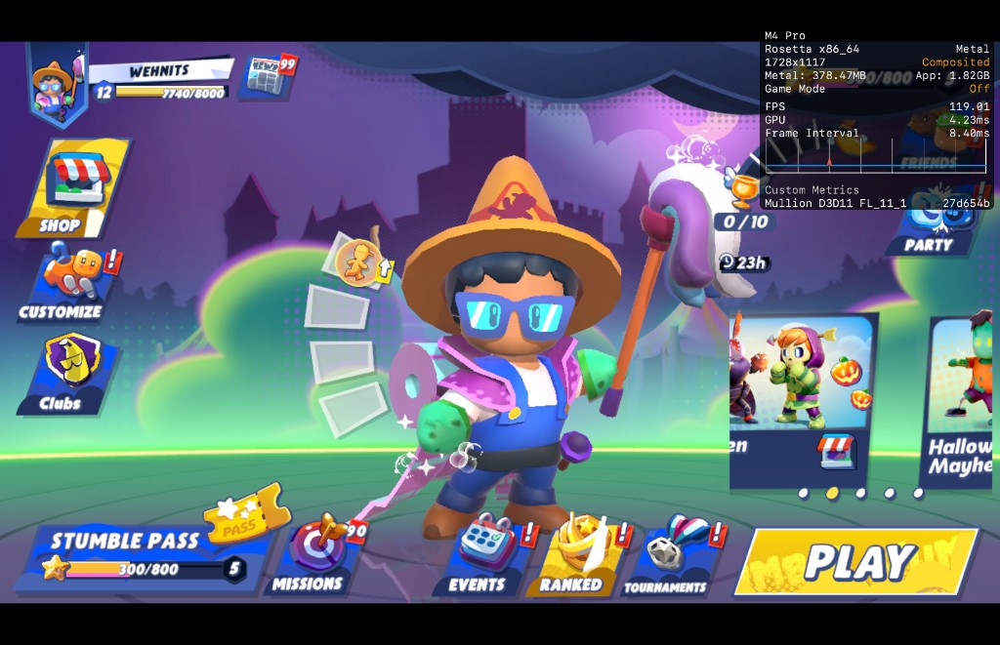
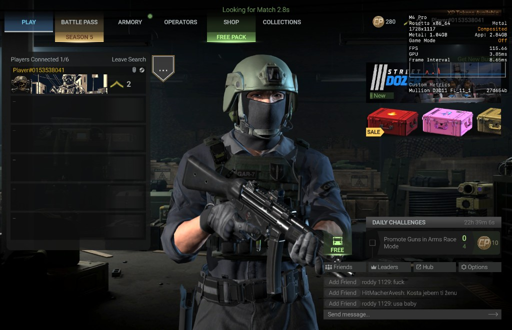
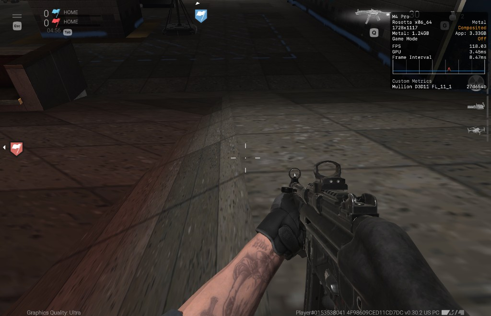

# CrossOver game tests (Mullion as DXMT)

Bottle: CrossOver **Steam**  
`CX_ROOT` = `~/Library/Mullion/CrossOver` (Mullion sitting in `lib/dxmt`)  
Host: Apple M4 Pro, macOS 26.5.2, CrossOver.app on the Desktop  
Mullion: commit `27d654b` (HUD on Stumble Guys and Combat Master)  
`MULLION_LOG_PATH` was **not** set. There is no `*_mullion.log`. Evidence is Steam overlay, Steam process log, Source minidumps, and HUD screenshots.

---

## Stumble Guys — pass (D3D11)

| | |
|---|---|
| AppID | 1677740 |
| Binary | `Stumble Guys.exe` (64-bit) |
| API | Direct3D 11 |
| Result | **Played.** Menu and character select rendered. |
| HUD | `Mullion D3D11 FL_11_1` · `27d654b` · M4 Pro · Rosetta x86_64 · ~120 FPS · GPU ~4.2 ms |
| Steam | Process 2504 ran ~1m50s, exit 0 (user quit) |



This is the first real-title confirmation that the bottle is loading Mullion, not stock DXMT or D3DMetal.

---

## Alien Swarm — fail (D3D9, 32-bit)

| | |
|---|---|
| AppID | 630 |
| Binary | `swarm.exe -novid +asw_stats_track 1` (32-bit Source) |
| API | Direct3D 9 |
| Result | **Dock icon appeared, then quit.** No window. |
| Steam | PID 1180 tracked 20:56:23–20:56:29, **exit code 100** |
| Dump | `steamapps/common/Alien Swarm/swarm_7935_crash_2026_10_30T0_56_25C0.mdmp` |

Steam overlay saw D3D9 come up:

```
Fri Oct 30 00:56:24 2026 UTC - Game is using D3D9 or D3D9Ex, preparing to hook.
Fri Oct 30 00:56:24 2026 UTC - hookDirect3DCreate9 called
```

Then the minidump:

```
wine: Call from 7BE788E0 to unimplemented function d3d9.dll.D3DPERF_SetOptions, aborting
```

**Why (commit `27d654b`):** that build’s `d3d9.dll` only exported `Direct3DCreate9` and `Direct3DCreate9Ex`. Source calls `D3DPERF_SetOptions` (PIX stub on real `d3d9.dll`). Wine aborts unimplemented PE exports. The process never got as far as a swap chain or a draw, so there is no HUD screenshot.

**Current source:** `src/d3d9/d3d9.def` exports the 17 names, including `D3DPERF_SetOptions`, `D3DPERF_BeginEvent`, `D3DPERF_EndEvent`, and `D3DPERF_SetMarker`. Those calls return without drawing. This log is not a retest of Alien Swarm on that table.

That is a missing export, not a refused CreateDevice. Fullscreen (`swarm/cfg/video.txt` has `setting.fullscreen 1`) was not reached.

No gameplay image: the game never presented a frame.

---

## CS2 — fail (D3D11, 64-bit, then d3d9 PIX stub)

| | |
|---|---|
| AppID | 730 |
| Binary | `game\bin\win64\cs2.exe -steam` (64-bit Source 2) |
| API | Direct3D 11 (`rendersystemdx11.dll`) plus PIX markers from `d3d9.dll` |
| Result | **Crashed twice.** Dock/process came up ~19s, Steam error reporter, no window, no frame. |
| Steam | PID 1580 21:13:25–21:13:44 and PID 2920 21:13:52–21:14:10, both **exit -2147483392** (`0x80000100`, Wine `EXCEPTION_WINE_STUB`) |
| Dumps | `game/bin/win64/cs2_2026_1029_211330_0_crash.mdmp` and `cs2_2026_1029_211357_0_crash.mdmp` |

Installed Mullion `d3d9.dll` (`lib/dxmt/x86_64-windows/d3d9.dll`, `SizeOfImage 0x147000`) is what loaded. Overlay saw DXGI:

```
Fri Oct 30 01:13:59 2026 UTC - Game is using dxgi (dx10/dx11), preparing to hook.
```

Source 2 console in the dump (uptime 0.86s, `g_pRenderDevice` still NULL, `Vid: 0 x 0`):

```
12(0.848082):  Creating render device for graphics adapter 0 'Apple M4 Pro' [VendorId 0x1002 / DeviceId 0x0]: 0.0.10.0
17(0.857798):  Failed to save video settings config to 'cfg\cs2_video.txt'
```

Minidump exception `0x80000100` from `ntdll.RaiseException`. The two Wine stub arguments resolve inside `rendersystemdx11.dll`'s import names:

- module: `d3d9.dll`
- function: `D3DPERF_BeginEvent`

That DLL **statically imports** from `d3d9.dll`: `D3DPERF_BeginEvent`, `D3DPERF_EndEvent`, `D3DPERF_SetMarker`, `Direct3DCreate9`. At commit `27d654b`, Mullion `d3d9.def` only exported `Direct3DCreate9` / `Direct3DCreate9Ex`. Wine bound the missing PIX names to unimplemented stubs; the first `D3DPERF_BeginEvent` during device create aborted.

**Why (that commit):** same hole as Alien Swarm (`D3DPERF_SetOptions`), different symbol. CS2 is a real D3D11 title (adapter enumerated, DXGI factory used, `winemetal.dll` loaded) and died on Mullion `d3d9` PIX exports before a swap chain existed. Current `d3d9.def` exports those names. This log is not a retest.

`Failed to save ... cs2_video.txt` is a side effect (file never created). It is not the crash.

No gameplay image: the game never presented a frame.

---

## Combat Master — pass (D3D11), grazing textures smear

| | |
|---|---|
| AppID | 2281730 |
| Binary | `CombatMaster.exe` (64-bit Unity 6000.3.19f1) |
| API | Direct3D 11 FL 11.1 |
| Result | **Played into a match.** Menu, shop, matchmaking, then FPS view. HUD still Mullion. |
| HUD | `Mullion D3D11 FL_11_1` · `27d654b` · M4 Pro · Rosetta x86_64 · 1728×1117 · ~117–119 FPS · GPU ~3.1–3.5 ms |
| Steam | PID 3012 from 21:20:24 |
| Graphics | In-game overlay: **Graphics Quality: Ultra** |
| Unity log | `AppData/LocalLow/AlfaBravoInc/Combat Master/Player.log` — device `Apple M4 Pro`, Vendor **ATI**, Driver `65535.65535.65535.65535`. No CreateTexture / DXGI errors. `D3D11Fence is not available`. `!ftraceLightmaps` script missing. |





### The “3D texture” smear

The gun, arms, and HUD stay sharp. The **world** does not: the wooden ramp in the foreground and the floor going away smear along the view, like a volume slice instead of a 2D albedo on a plane. That is grazing-angle 2D sampling, not a failed `CreateTexture3D` (Unity never logged one; the match still presented).

`maxAnisotropy` *is* copied onto the Metal sampler (`winemetal_unix.c` `sampler_desc.maxAnisotropy = info->max_anisotroy`). The mismatch is how LOD is chosen:

Mullion’s own comment in `SampleImplicit` (`src/airconv/nt/dxbc_converter_base.hpp`): Metal applies mip bias to the **minor** axis of the anisotropic footprint **before** clamping the ratio; D3D11 biases LOD **after** the clamped footprint (`biasedLOD = output.LOD + MipLODBias`, D3D11.3 7.18.11). The `sample_grad` workaround that keeps the ratio only runs when `MipLODBias != 0`. Unity Ultra samplers are almost always bias 0, so Metal’s native aniso/mip is used. On a long floor/ramp UV that picks a mip that is too coarse, the albedo looks “3D-smeared.” Viewmodels do not (small triangles, unique UVs, close to camera).

Not a crash. Not the Alien Swarm / CS2 `D3DPERF_*` hole. No `MULLION_LOG_PATH`, so this is screenshot + Player.log + the sample path, not a captured frame.

---

## What to do next (not done here)

1. PIX stubs are exported from current `d3d9.def` (`D3DPERF_BeginEvent`, `D3DPERF_EndEvent`, `D3DPERF_SetMarker`, `D3DPERF_SetOptions`, `D3DPERF_GetStatus`, `D3DPERF_QueryRepeatFrame`, `D3DPERF_SetRegion`). Alien Swarm and CS2 have not been relaunched on that table.
2. Set `MULLION_LOG_PATH` on the bottle before the next launch.
3. Retry Alien Swarm with `-windowed`, then retry CS2. CS2 also loads `amd_ags_x64.dll` because the adapter is reported as AMD `0x1002`; that is a later risk, not the old crash.
4. Combat Master smear: confirm with a Metal frame capture (`DXMT_CAPTURE_FRAME` / F10) that grazing 2D samples pick a too-coarse mip; then make `SampleImplicit` keep the anisotropic footprint when `MaxAnisotropy > 1` even if `MipLODBias` is 0. Do not treat it as a Texture3D create bug without a failing `CreateTexture3D`.
